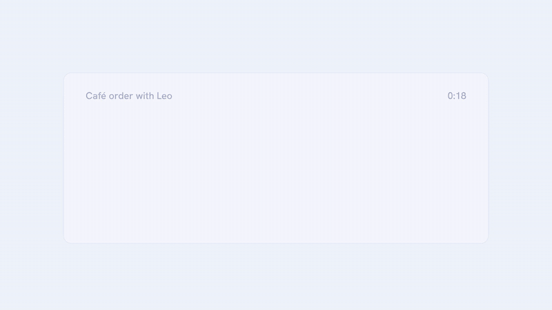

# SpeakUp

<p align="center">
  <a href="docs/media/speakup-demo.mp4">
    
  </a>
  <br>
  <sub>▶ 20-second demo. <a href="docs/media/speakup-demo.mp4">Watch the full video with sound</a>.</sub>
</p>

<p align="center">
  <a href="https://speakup-kfcg.onrender.com"><b>Live app: speakup-kfcg.onrender.com</b></a>
  <br>
  <sub>Login-only: registering needs the family signup code. The free server may take about a minute to wake up.</sub>
</p>

**An AI English-speaking tutor for my family.** You talk out loud to an AI partner in real-life situations: a job interview, a salary conversation, a doctor's appointment. Every sentence comes back corrected, with the mistake struck through and the better version highlighted, and a short reason why. Speak first. We tidy the grammar after.

It's a full-stack app: React on the front, Node.js and Express on the back, MongoDB Atlas for data and Google Gemini for the AI. One server serves both the API and the built React app.

## Features

**Speaking practice**
- **11 role-play scenes** in three groups: Professional, Friends and family, Everyday life. Each one has an AI character with a mood (cheerful, neutral, stressed or annoyed).
- **Interview mode:** practise a job interview for any role, focused on HR and behavioural, situational or campus-placement questions. You get a scorecard at the end that rates clarity, structure, relevance, vocabulary and confidence.
- **Debate mode:** 12 topics; pick a side and argue it against the AI. You get a scorecard at the end.
- **Your own people:** describe a real boss, colleague or relative, and practise a conversation with them.
- **Voice in, voice out:** speech recognition and text-to-speech in the browser. You can also type.
- **Corrections in context:** each sentence comes back corrected, with a more natural version and every mistake labelled by type (tense, article, preposition, and so on).

**Writing, reading, grammar and vocabulary**
- **Writing check:** paste or upload an email or essay (`.txt` or `.docx`). You get a score, line-by-line corrections, feedback on structure, tone and vocabulary, and a rewritten version.
- **Read aloud:** 9 passages. The app follows your voice word by word and measures accuracy and words per minute.
- **Grammar:** 11 short lessons with quizzes, plus a quiz built from **your own** past mistakes.
- **Vocabulary:** 120 starter words and AI lookups for any word. Spaced-repetition review: cards come back after 1, 3, 7, 14 and 30 days.

**Progress and family**
- **Dashboard and progress:** streaks, minutes per day, mistakes by type over time, and words learned.
- **History:** search past conversations, re-read transcripts, and print them.
- **Family admin:** members register with a family signup code. The admin can manage members and reset passwords, but **can't read anyone's practice**.
- Works on phones (bottom tab bar), installs as an app (web manifest and icons), and is built on one design-token system for colour, type and motion.

## Tech stack

| Layer | Tools |
|---|---|
| Front end | React 19, React Router 7, Vite, Tailwind CSS 4, Motion, Phosphor icons, axios |
| Back end | Node.js (22+), Express 5, Mongoose 9, zod validation |
| AI | Google Gemini (`@google/genai`), JSON-schema replies, automatic fallback to other models when one is busy |
| Data | MongoDB Atlas |
| Security | JWT in an HttpOnly cookie, bcrypt, Helmet with a strict Content-Security-Policy, rate limits, CSRF origin check |
| Hosting | One Render web service (`render.yaml` blueprint) |

## How it works

```
Browser (React app)
   │  same origin: /api/*        (no CORS needed in production)
   ▼
Express server ──────────────► Google Gemini
   │  validates every request,     learner text goes in fenced tags;
   │  scopes every query to the    every reply is schema-checked
   │  logged-in user               before it's saved
   ▼
MongoDB Atlas
```

- **Corrections are reliable.** The AI must reply in a fixed JSON shape. A malformed reply becomes a friendly error and is never saved. Scores and "correct" flags are computed by the server, not taken from the AI.
- **Costs are capped.** Each member gets 15 AI requests a minute and 100 a day (configurable). The daily count is one atomic database update, so parallel requests can't get past it.

## Security

The app went through a white-box security review: an authorisation matrix of **58 routes × 4 kinds of user (232 checks, 0 failures)**, plus injection, prompt-injection, XSS and race-condition testing. Every finding was fixed or documented, and has a regression test. See **[SECURITY.md](SECURITY.md)** for the threat model, protections and findings.

## Run it locally

You need Node.js 22 or newer, a MongoDB Atlas database (the free tier is fine) and a Gemini API key from [Google AI Studio](https://aistudio.google.com).

```bash
git clone https://github.com/AtharvDoiphode/speakup.git
cd speakup

# Settings: copy the example and fill in your own values
cp server/.env.example server/.env

npm install --prefix server
npm install --prefix client

# Two terminals
npm run dev --prefix server    # API on http://localhost:5000
npm run dev --prefix client    # app on http://localhost:5173
```

Register with the email you set as `ADMIN_EMAIL` first; that account becomes the admin. Every variable is explained in [`server/.env.example`](server/.env.example).

To run it the way production does (one server for the app and the API):

```bash
npm run build
NODE_ENV=production npm start   # http://localhost:5000
```

## Tests

```bash
npm test
```

This runs:
- **Server:** unit tests and the security suite. The suite makes its own throwaway database and drops it afterwards.
- **Client:** brand, design-token, motion and UX checks. Includes colour-contrast and "no raw colours or durations outside the tokens" lint tests.

## Deploying

The app deploys to Render as a single web service from [`render.yaml`](render.yaml). [DEPLOY.md](DEPLOY.md) has the step-by-step guide: Atlas setup, environment variables, health check and post-deploy checks.

## Project structure

```
client/            React app (Vite)
  src/pages/       one file per screen
  src/components/  shared UI: voice orb, corrected line, scorecard, charts…
  src/styles/      design tokens (colours, type, motion)
  scripts/         icon generator and design-system tests
server/
  src/routes/      Express routes, one file per feature
  src/controllers/ request handlers
  src/models/      Mongoose models
  src/prompts/     the prompt for each AI feature
  src/middleware/  auth, rate limits, daily AI cap
  tests/           unit and security tests
design/            logo concepts and colour palette explorations
render.yaml        Render blueprint
```

## Author

Built by **Atharva Doiphode**.
